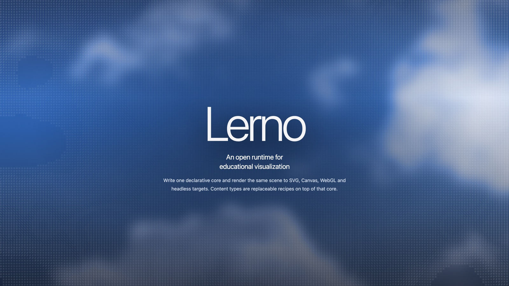

# Lerno

**A framework-agnostic engine for educational content.** Declarative content types, a deterministic
session runtime, a grading layer, and K-12 STEM kernels. Framework-free and renderer-free.

[](./LICENSE)
[](./src/index.ts)

Lerno knows nothing about your application stack: no database, no realtime transport, no object
storage, no xAPI, no LLM. Everything of that kind arrives from the outside through `LernoHost`
adapters and `LernoExtension` packages, so the core stays small and testable.

## Ecosystem

This repository is the core. Players, renderers and integrations ship from their own repositories and
take `@medu/lerno` as a dependency or a peer dependency:

| Repository | Package | Contents |
| --- | --- | --- |
| this repository | `@medu/lerno` | Content model, session runtime, grading, discipline kernels, low-level 2D engine |
| [lerno-react](https://github.com/trymedu/lerno-react) | `@medu/lerno-react` | `Display`, hooks, `LernoPlayer`, and interactive STEM labs |
| [lerno-three](https://github.com/trymedu/lerno-three) | `@medu/lerno-three` | Three.js scene, variable management, bindings |
| [lerno-motion](https://github.com/trymedu/lerno-motion) | `@medu/lerno-motion` | Spring, keyframes, sequence, stagger |
| [lerno-export](https://github.com/trymedu/lerno-export) | `@medu/lerno-export` | Headless MP4 export: frames, canvas rasterizer, ffmpeg encoder |
| [lerno-plugin-xapi](https://github.com/trymedu/lerno-plugin-xapi) | `@medu/lerno-plugin-xapi` | Telemetry events to xAPI statements |
| [lerno-plugin-mastery](https://github.com/trymedu/lerno-plugin-mastery) | `@medu/lerno-plugin-mastery` | Threshold-based adaptive flow and mastery report |

The documentation lives in [trymedu/lerno-docs](https://github.com/trymedu/lerno-docs).

---

## Layers

| Layer | Contents |
| --- | --- |
| **Content model** | `LernoDocument` + zod schemas (`slide`, `question`, `media`, `branch`, `info`, `cards`, `hotspot`, `custom`) |
| **Runtime** | `createSession`: flow, answering, scoring, progress; `Timeline` |
| **Grading** | `defineQuestion` + built-in graders, misconception tags |
| **Extension system** | `LernoRegistry` (node, question, flow, component) + `LernoHost` adapters |
| **Discipline kernels** | `FunctionPlotter` (`function-graph`), `ProjectileSimulation`, `Molecule2D`, `CoordinatePlane`, `CalculusEngine` |
| **Low-level engine** | scene graph (`scenery`), observables (`axon`), geometry (`kite`, `dot`), animation (`twixt`), simulation loop (`sim`) |

---

## Install

No package is on npm yet. Clone this repository, run `bun install && bun run build`, then point your
application at the package. `zod` is the only runtime dependency. Requires Node 20 or newer.

## Quick start

```ts
import { createSession, defineDocument } from '@medu/lerno';

const document = defineDocument({
  id: 'lesson-1',
  type: 'lesson',
  metadata: { title: 'Quadratic Functions' },
  nodes: [
    { id: 's1', type: 'slide', blocks: [{ type: 'text', markdown: 'Hello' }] },
    {
      id: 'q1',
      type: 'question',
      item: {
        kind: 'multiple-choice',
        prompt: 'For f(x) = x², what is f(2)?',
        choices: [
          { id: 'a', label: '2' },
          { id: 'b', label: '4' },
        ],
        correct: ['b'],
      },
    },
  ],
});

const session = createSession(document);
session.next(); // 'q1'
session.answer('q1', { selected: ['b'] }); // { status: 'correct', score: 1, maxScore: 1 }
session.score(); // { earned: 1, max: 1, ratio: 1, passed: null }
```

`session.getState()` returns a plain serializable snapshot; pass it back as
`createSession(document, { state })` to resume where the learner left off.

## Entry points

| Import | Brings in |
| --- | --- |
| `@medu/lerno` | Everything below |
| `@medu/lerno/core` | Scene graph, observables, geometry, animation, sim loop; no zod, no content schema |
| `@medu/lerno/session` | `createSession` and the session state contract |
| `@medu/lerno/content` | Document schema, presets, migrations |
| `@medu/lerno/grading` | Question definitions and graders |
| `@medu/lerno/extensions` | `LernoRegistry`, `LernoHost`, `createLerno` |

Reach for `core` when a surface only draws and animates; reach for the package root when it also
loads documents or grades answers.

## Extensions

```ts
import { createLerno, defineExtension } from '@medu/lerno';

const extension = defineExtension({
  name: 'my-extension',
  setup(registry) {
    registry.addNode({ type: 'flashcard', label: 'Card' });
    registry.addComponent({ type: 'ui.switch', version: 1 });
    registry.addFlow('always-first', (document) => document.nodes[0]?.id ?? null);
  },
});

const { registry, host } = createLerno({ extensions: [extension] });
```

The core recognizes only the types registered on the registry, so new node kinds, question kinds and
flow resolvers ship as separate repositories instead of changes to the core.

## Determinism

Two host adapters make a run reproducible: `host.clock()` and `host.random()`. Provide your own and
the same document answers with the same state, which is what recording, replaying and headless
rendering rely on.

```ts
const { host } = createLerno({
  host: { clock: () => frameIndex * 16.6, random: () => 0.5 },
});
```

## Development

```bash
bun install
bun run lint
bun run type-check  # strict, no `any`
bun run test        # jest, 28 suites
bun run build       # CJS + ESM + declarations into dist/
```

## License

[MIT](./LICENSE) © Lerno contributors
